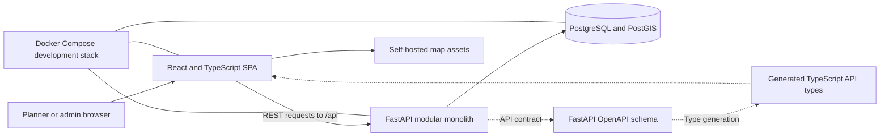
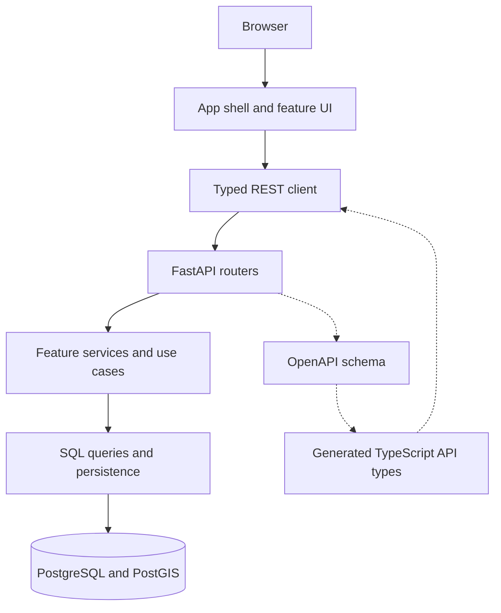

# Fiber Dashboard Architecture Assessment

Assessment of the repository structure and implementation as inspected on 17 November 2026.
The product requirements are in [PRD](../docs/PRD.md); the documented stack and design are in
[architecture](../docs/architecture.md).

## Summary

The application is a three-tier system: a React/Vite frontend, a FastAPI modular monolith, and
PostgreSQL/PostGIS. The API is REST, with TypeScript API types generated from FastAPI's OpenAPI
schema. The documented target is a modest MVP (up to 50 concurrent users); the main likely
scaling concerns are broad map and inventory reads, repeated route-planning queries, and
process-local routing cache invalidation—not the choice of framework.

The code has useful foundations: feature-oriented API modules, typed API contracts, database
constraints for important invariants, append-only reservation history, and PostGIS support.
The main maintainability concerns are app-wide frontend coordination, SQL and business logic
sharing large service modules, and an unclear production-serving topology in the repository's
Docker configuration.

## Current architecture



### Frontend

- React and TypeScript are built and served by Vite. Feature UI is primarily under
  `web/src/components/`, with state and utilities under `web/src/lib/`.
- The OpenAPI-generated schema and typed REST client are under `web/src/api/`.
- The app shell in [App.tsx](../web/src/App.tsx) coordinates views, selection, inventory state,
  and dialogs. This is a likely change hotspot as the UI grows.
- Feature code is spread across flat component and library directories. Grouping by product
  feature would make ownership and dependencies easier to follow.
- Custom hooks manage request state and refresh behavior. This is simple for the MVP, but
  repeated loading, cache, and invalidation logic may become inconsistent across screens.
- Multipart upload and reservation-action client paths contain handwritten type casts. These
  are limited exceptions to the otherwise generated API typing.

### Backend

- FastAPI routers are assembled in [main.py](../api/app/main.py). The app has feature packages
  for auth, inventory, reservations, loss, map, routing, ingest, and admin edits.
- Routers, schemas, and service modules provide a useful starting separation.
- Some services mix SQL definitions, persistence operations, and business rules. For example,
  see [inventory/service.py](../api/app/inventory/service.py) and
  [reservations/service.py](../api/app/reservations/service.py). This is workable now, but
  modules may become harder to change as use cases and read models expand.
- Cross-feature service calls (for example, routing using inventory and loss services) should
  be kept intentional to avoid circular dependencies and duplicated work.
- Scheduled jobs and notifications are documented as planned, not implemented. The
  `job_runs` table exists, but no running job currently records to it.

### Database

- PostgreSQL with PostGIS is accessed through SQLAlchemy and psycopg; Alembic manages schema
  migrations. See [models.py](../api/app/models.py) and
  [the baseline migration](../api/alembic/versions/0001_baseline.py).
- Database constraints protect important invariants, while views derive core and reservation
  status. Append-only reservation events preserve history.
- Derived status and history queries may become more expensive as append-only tables grow.
  Monitor query plans and indexes for the actual access patterns before adding more machinery.
- Some inventory and map responses are broad rather than viewport- or cursor-bounded. This can
  increase query cost, serialization time, and response size as network data grows.
- Preserve forward-only migration discipline once production data exists.

### GraphQL

No GraphQL schema, server, resolver, or client was found in the inspected repository. The
implemented API is REST with OpenAPI-generated TypeScript types. This is a reasonable fit for
the current product; adding GraphQL without a demonstrated client need would add another
contract and operational surface, not solve scaling by itself.

### Docker and deployment

- [docker-compose.yml](../docker-compose.yml) defines PostGIS, FastAPI, and Vite services.
- The Compose API command uses Uvicorn reload, and the web image runs the Vite development
  server. This is a development setup, not a clearly specified production serving path.
- Production web serving, API worker configuration, and the edge/TLS boundary should be
  documented and configured separately before production deployment.

## Separation of concerns and architectural risks

| Area | Assessment |
| --- | --- |
| Frontend composition | The app shell coordinates many concerns; move feature-specific state and dialogs closer to their features as they change. |
| Frontend organization | Flat component and library folders obscure feature boundaries. |
| Backend services | Feature modules exist, but large services combine SQL, persistence, and business logic. |
| Database | Constraints and derived views are strengths; monitor append-only history query cost. |
| API contract | OpenAPI-generated types are a strength; contain handwritten client casts. |
| Deployment | Development setup is explicit; production serving and process topology need definition. |
| Background work | Scheduler and notification responsibilities are planned but not yet running. |

## Likely scaling bottlenecks

1. **Map and inventory payloads:** broad GeoJSON and inventory reads can become expensive.
   Consider viewport/bounding-box queries and bounded responses as data or usage grows.
   See [map/service.py](../api/app/map/service.py).
2. **Route planning reads:** route requests retrieve inventory and loss data across segments
   alongside candidate paths. Profile this flow as segment counts grow.
   See [routing/service.py](../api/app/routing/service.py).
3. **Routing graph cache:** the graph is process-local. Multiple workers or replicas can retain
   stale graph data after edits if invalidation is not shared or versioned.
   See [routing/graph.py](../api/app/routing/graph.py).
4. **Database connection count:** each API worker has its own connection pool. Set pool and
   worker limits together with the database capacity.
5. **History growth:** append-only events and edits are intentional. Monitor table/index size
   and query latency; consider partitioning or archival only when measurement justifies it.

## Recommended folder organization

Treat this as a gradual destination, not a bulk move. Keep feature-specific code together and
reserve shared directories for code genuinely shared across features.

```text
web/src/
  app/                 # App shell and page/view composition
  features/
    inventory/
    reservations/
    routing/
    admin/
    loss/
  shared/
    api/               # REST client and generated OpenAPI types
    components/
    hooks/
    lib/
  main.tsx

api/
  app/
    auth/
    inventory/
    reservations/
    routing/
    loss/
    ingest/
    admin_edits/
    main.py
    db.py
    models.py
  alembic/
    env.py
    versions/

docker/                # Optional production/deployment configuration
```

Add backend query/repository modules only where they reduce real coupling or improve
testability. Keep Alembic near the backend while migrations depend on the app's Python
package. GraphQL folders are intentionally omitted.

## Recommended internal layering



## Priorities

1. Define and document the production-serving topology separately from the Vite/Uvicorn
   development setup.
2. Bound map and inventory reads; measure response sizes and query latency.
3. Ensure routing cache invalidation remains coherent if API workers or replicas increase.
4. Reduce frontend app-shell coordination by keeping feature state and dialogs near their
   feature code.
5. Extract backend query modules selectively when service size or cross-feature coupling
   becomes a recurring source of change risk.

This assessment reflects the checked-in repository and its documentation. External deployment
configuration may change the production picture.
