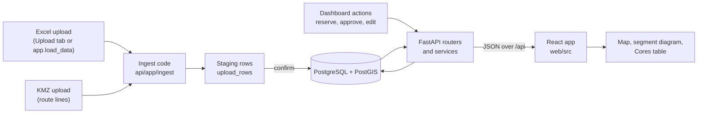
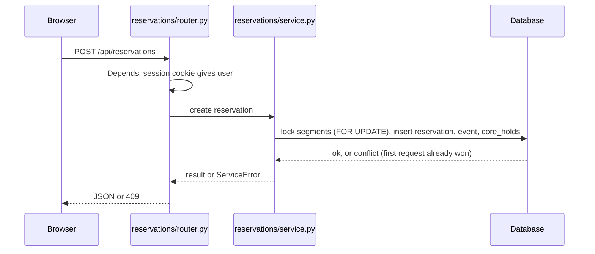
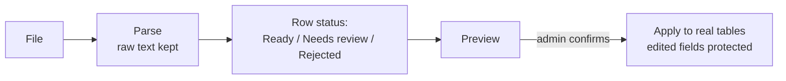

# Learning guide to the Fiber Dashboard code

Last verified: 2026-11-20, commit 092783e

This guide is for an owner who is new to software. It describes the code as it is on the `dev` branch. Paths are from the repository root.

## 1. Big picture

The app tracks fiber cable capacity. A Site is a place. A Segment is one cable between two Sites. A Segment has Cores (single fibers). Planners find free Cores on the map and reserve them. Admins approve reservations, load data from Excel and KMZ files, and edit the data.

Data flow, from input to screen:

Read it left to right. Files are checked and kept raw in staging first. Only after the admin confirms are they written to the real tables. The screen never reads files. It asks the API, and the API reads the database.

## 2. Module tour

### Backend entry point
- What it does: creates the FastAPI app, plugs in every router, turns domain errors into HTTP answers, and has the `/api/health` and `/api/ready` checks.
- Key files: `api/app/main.py`, `api/app/errors.py`, `api/app/db.py`, `api/app/environment.py`, `api/app/observability.py`.
- Called by: Uvicorn (the server process) from `docker-compose.yml`.

### Backend routers and services
Each area has a `router.py` (the web address and input checks), a `service.py` (the rules and the SQL) and often a `schemas.py` (the shape of data in and out).
- `api/app/inventory/`: sites, segments, cores, search, the Cores table data. Called by the web app on every page.
- `api/app/reservations/`: request, approve, reject, withdraw, keep, release, correct, assign. Called by the Reserve box, My reservations and Approvals.
- `api/app/loss/`: Calculated loss and Measured loss per core. Called by the core details and the Reserve box.
- `api/app/routing/`: finds route options between two Sites using a graph of Segments (`graph.py`). Called by the route planner on the map page.
- `api/app/map/`: segment lines and site points for the map. Called by `web/src/lib/useNetworkMap.ts`.
- `api/app/admin_edits/`: admin edits to Sites, Segments, ports and measurements, with Remarks. Called by the edit dialogs.
- `api/app/history.py`: the edit and event history views.
- `api/app/auth/`: login, logout, users, roles. Called by the login screen, the account menu and the Users tab. `deps.py` holds the checks every router uses.

### Upload and parsing
- What it does: reads Excel and KMZ files, keeps every row raw, gives each row a status (Ready, Needs review, Rejected), shows a preview, and applies it on confirm.
- Key files: `api/app/ingest/excel.py`, `api/app/ingest/checks.py`, `api/app/ingest/uploads.py`, `api/app/ingest/upload_file.py`.
- Shared steps: `api/app/ingest/pipeline.py` (staged rows store, apply skeleton) and `api/app/ingest/segment_fields.py` (the one segment column writer). Each kind keeps its own parse, evaluate and row writes.
- Protection: a field is protected from uploads when it has a `data_edits` row with no `upload_id` (a dashboard edit). Uploads and `app.load_data` fill `upload_id`; remarks text does not matter.
- Site master: `api/app/ingest/site_master/` (`parse.py`, `stage.py`, `evaluate.py`, `apply.py`) and `api/app/ingest/site_master_router.py`.
- Reservation workbook: `api/app/ingest/reservation_upload.py` and `reservation_upload_router.py`.
- Segment list: `api/app/ingest/segment_list.py` and `segment_list_router.py`.
- KMZ lines: `api/app/ingest/kmz.py`, used by `kmz_router.py` and the command `api/app/load_kmz.py`.
- Called by: the Upload tab (`web/src/components/Upload.tsx`) and the commands `app.load_data` and `app.load_kmz`.

### Small helpers
- `api/app/link_type.py`: the SQL that works out Route type (DC-DC, DC-TOC, Metro, Trunk) from the kinds of the two end Sites. Route type is never stored. Used by the inventory, map and routing queries.
- `api/app/port_label.py`: reads a port label such as `FDF1-MOD2-T3-P5` or `ODF1-P5` and gives one clean form. Used by the ports edit and paste ports. The web twin is `web/src/lib/portLabel.ts`.

### Database models and migrations
- What it does: the tables, views and rules that keep data correct.
- Key files: `api/app/models.py` (Python view of the tables), `api/alembic/versions/0001_baseline.py` (all tables, the views `core_status_v`, `reservation_state_v`, `reservation_unassigned_v`, and the triggers) and migrations `0002` to `0007`.
- Called by: `alembic upgrade head`. The API checks the version at `/api/ready`.

### Web app shell and tabs
- What it does: login, header with tabs, and the views. Tabs are Inventory and My reservations. Admins also see Approvals and Upload. Users is in the account menu.
- Key files: `web/src/main.tsx`, `web/src/App.tsx`, `web/src/components/Header.tsx`, `web/src/components/InventoryView.tsx`, `web/src/components/reservations/` (My reservations, Approvals, cards), `web/src/components/Users.tsx`.
- Called by: the browser loads `web/index.html`, which loads `main.tsx`.

### Map
- What it does: draws the basemap, Site points, Segment lines and the route planner.
- Key files: `web/src/components/NetworkMap.tsx`, `MapSites.tsx`, `MapOverlay.tsx`, `MapPanels.tsx`, `RoutePlanner.tsx`, `web/src/lib/basemap.ts`, `mapGeometry.ts`, `useNetworkMap.ts`.
- Called by: `InventoryView.tsx`.

### Segment panel, diagram and Cores table
- Key files: `web/src/components/SegmentPanel.tsx`, `NetworkDetail.tsx`, `CoresTable.tsx`, `CoreDrawer.tsx`, `ReserveBox.tsx`.
- Called by: `App.tsx` and `InventoryView.tsx`.

### Hooks and API client
- What it does: hooks keep the state and do the loading. The API client sends requests to `/api` and hands back typed answers.
- Key files: `web/src/api/client.ts`, `web/src/api/schema.d.ts` (generated, do not edit by hand), `web/src/lib/useInventory.ts`, `useLoad.ts`, `useAuthGate.ts`, `useReserveBox.ts`, `useAdminEdit.ts`.
- Called by: nearly every component.

### Scripts and commands
- `scripts/get-tiles.sh`: downloads the map file and fonts.
- `scripts/backup-db.sh` and `scripts/restore-check.sh`: backup and restore drill.
- `api/app/create_admin.py`: makes the first admin.
- `api/app/load_data.py` and `api/app/load_kmz.py`: load files from the command line.
- `api/app/seed_dev.py`, `seed_dev_network.py`, `seed_dev_loss.py`: DEV data only.

## 3. Concepts used here

### REST API
- In simple words: a restaurant menu. The browser asks for a named thing (a URL plus GET, POST) and gets an answer in JSON.
- Where in our code: `api/app/main.py`, every `router.py`, `web/src/api/client.ts`.
- Why it's used here: it keeps the screen and the rules apart.
- Learn more: REST API basics HTTP methods

### FastAPI routers
- In simple words: a router is a section of the menu. Each area (reservations, loss) has its own section.
- Where in our code: `api/app/reservations/router.py`, plugged in by `api/app/main.py`.
- Why it's used here: one file per area stays small and easy to find.
- Learn more: FastAPI APIRouter

### Dependency injection (Depends)
- In simple words: a waiter who brings a tool to the cook before the cook asks. The route says "I need a database session" or "I need an admin" and FastAPI supplies it.
- Where in our code: `api/app/db.py` (`get_db`), `api/app/auth/deps.py` (`get_current_user`, `require_admin`, `DB`, `Admin`).
- Why it's used here: login and admin checks are written once, not in every route.
- Learn more: FastAPI Depends dependency injection

### Service layer and domain errors
- In simple words: the router is the front desk, the service is the back office that holds the rules. The service says what went wrong and the front desk turns it into an answer.
- Where in our code: `api/app/reservations/service.py`, `api/app/errors.py` (`ServiceError`), handler in `api/app/main.py`.
- Why it's used here: rules can be tested without a web server.
- Learn more: service layer pattern

### SQL and PostgreSQL
- In simple words: a very strict spreadsheet program. Tables hold rows, and rules reject bad rows.
- Where in our code: SQL text sits in named constants in `api/app/*/service.py`, tables in `api/alembic/versions/0001_baseline.py`.
- Why it's used here: the database is the source of truth after the first import.
- Learn more: PostgreSQL tutorial SELECT JOIN

### SQL views
- In simple words: a saved question that looks like a table. Ask it and you get the current answer.
- Where in our code: `core_status_v`, `reservation_state_v`, `reservation_unassigned_v` in `api/alembic/versions/0001_baseline.py`.
- Why it's used here: Core status (Available, Requested, Reserved, In service) is worked out, never stored by hand.
- Learn more: PostgreSQL CREATE VIEW

### PostGIS geometry
- In simple words: a map pin and a line drawn in a database column, plus tools to ask questions about them.
- Where in our code: `api/app/models.py` (`Geometry`), `api/app/map/service.py` (`ST_AsGeoJSON`), `api/app/ingest/site_master/apply.py` (`ST_MakePoint`).
- Why it's used here: Site points and road-shaped Segment lines live next to the other data.
- Learn more: PostGIS ST_MakePoint ST_AsGeoJSON

### pg_trgm
- In simple words: a spell-check for names. It scores how alike two words are, so "Acme Ltd" still finds "ACME Limited".
- Where in our code: created in `api/alembic/versions/0001_baseline.py`; `similarity(...)` in `api/app/inventory/service.py`.
- Why it's used here: customer search and customer matching forgive typos.
- Learn more: PostgreSQL pg_trgm similarity

### Alembic migrations
- In simple words: a numbered change log for the database. Each step moves the tables from one shape to the next, like renovation steps on a house.
- Where in our code: `api/alembic/versions/`, `api/alembic/env.py`, `api/alembic.ini`, the check in `api/app/main.py` (`/api/ready`).
- Why it's used here: every machine gets the same tables.
- Learn more: Alembic migrations tutorial

### Transactions and row locks (core_holds)
- In simple words: a transaction is a bank transfer, all steps or none. A lock is a "do not disturb" sign on a row. `core_holds` has one row per held Core, and only one can exist, so the first request wins.
- Where in our code: `core_holds` in `api/alembic/versions/0001_baseline.py`; `FOR UPDATE` and `IntegrityError` in `api/app/reservations/service.py`; lock timeout in `api/app/db.py`; race tests in `api/tests/test_reservation_races.py`.
- Why it's used here: two planners must not book the same Core.
- Learn more: PostgreSQL SELECT FOR UPDATE row locking

### Event sourcing / insert-only events (reservation_events)
- In simple words: a bank statement. You never erase a line; you add a new line. The balance is worked out from all lines.
- Where in our code: `ReservationEvent` in `api/app/models.py`, table `reservation_events` and the `forbid_change` trigger in `api/alembic/versions/0001_baseline.py`, `api/app/reservations/service.py`, `api/app/history.py`.
- Why it's used here: release is not deletion, and every change has a user and a time.
- Learn more: event sourcing append-only log

### Database triggers
- In simple words: a guard at the door of a table. Any attempt to change an old row is stopped.
- Where in our code: `forbid_change()` in `api/alembic/versions/0001_baseline.py`, attached to `reservations`, `reservation_events`, `reservation_cores`, `assign_cores`, `release_cores`, `data_edits` and `measurements`.
- Why it's used here: history cannot be edited, even by mistake.
- Learn more: PostgreSQL triggers

### Staging tables for uploads
- In simple words: a loading dock. Boxes are opened and labelled there before anything goes onto the shelves.
- Where in our code: `uploads` and `upload_rows` in `api/alembic/versions/0001_baseline.py`; `api/app/ingest/uploads.py`; `api/app/ingest/site_master/stage.py`.
- Why it's used here: a bad row is marked Needs review or Rejected and never blocks the rest; raw text is always kept.
- Learn more: ETL staging table data import

### Excel and KMZ parsing
- In simple words: reading someone else's handwriting. The reader keeps the original text and writes its reading beside it.
- Where in our code: `api/app/ingest/excel.py`, `api/app/ingest/site_master/parse.py`, `api/app/ingest/kmz.py`.
- Why it's used here: real files are messy, and the parser must not guess values.
- Learn more: openpyxl read xlsx

### Session cookie auth
- In simple words: a wristband at a festival. You log in once, get a band, and show it on every request.
- Where in our code: `api/app/auth/router.py` (`set_cookie`), `api/app/auth/deps.py` (`get_session_user`), table `sessions`.
- Why it's used here: every write must be tied to a user. The cookie is `httponly`, so page scripts cannot read it.
- Learn more: session cookie HttpOnly authentication

### Roles (planner and admin)
- In simple words: a key card with levels. Planners open some doors, admins open all.
- Where in our code: `require_admin` in `api/app/auth/deps.py`; `Admin` used in `api/app/ingest/` and `api/app/admin_edits/`.
- Why it's used here: only admins upload, approve and edit.
- Learn more: role based access control

### Graph and shortest path (NetworkX)
- In simple words: a road map where Sites are towns and Segments are roads with a length. The program finds the best trips.
- Where in our code: `api/app/routing/graph.py`, `api/app/routing/service.py`.
- Why it's used here: any Site can route to any Site, over Segments weighted by km.
- Learn more: NetworkX shortest path

### OpenAPI and a generated TypeScript client
- In simple words: the API prints its own menu, and a tool turns the menu into types for the web app.
- Where in our code: `web/package.json` (script `gen:api`), `web/src/api/schema.d.ts`, `web/src/api/client.ts`.
- Why it's used here: the web app fails to build if it uses a field the API does not have.
- Learn more: openapi-typescript

### React components
- In simple words: Lego bricks. Each brick draws one part of the screen and bricks fit inside bricks.
- Where in our code: `web/src/components/`, top brick in `web/src/App.tsx`.
- Why it's used here: each screen part (Cores table, Reserve box) is one file.
- Learn more: React components props

### React hooks
- In simple words: a brick's memory and helpers. `useState` remembers a value; a custom hook bundles memory and loading for one job.
- Where in our code: `web/src/lib/use*.ts`, for example `useInventory.ts`, `useLoad.ts`, `useAuthGate.ts`.
- Why it's used here: components stay short; state and handlers live in hooks.
- Learn more: React hooks useState useEffect

### TypeScript types
- In simple words: labels on boxes. The checker refuses to put a number in a box labelled text.
- Where in our code: `web/src/api/schema.d.ts`, `web/src/lib/status.ts`, `web/tsconfig*.json`.
- Why it's used here: mistakes show up while typing, not in front of users.
- Learn more: TypeScript handbook basic types

### Vite
- In simple words: the kitchen that prepares the web app for the browser, with a fast live preview while you edit.
- Where in our code: `web/vite.config.ts`, `web/index.html`, `web/package.json`.
- Why it's used here: dev server on port 5173; production gets a built copy served by the API.
- Learn more: Vite getting started

### MapLibre and PMTiles
- In simple words: MapLibre draws the map. PMTiles is the whole map in one file on our own server, so no outside map service is called.
- Where in our code: `web/src/lib/basemap.ts` (`addProtocol("pmtiles", ...)`), `web/src/components/NetworkMap.tsx`, `scripts/get-tiles.sh`.
- Why it's used here: no data leaves the network.
- Learn more: MapLibre GL JS PMTiles

### Docker Compose
- In simple words: a recipe that starts the database, the API and the web server together, the same way on every machine.
- Where in our code: `docker-compose.yml`, `api/Dockerfile`, `web/Dockerfile`, `db/initdb/10_postgis.sh`, `.env.example`.
- Why it's used here: `dev` and `main` each run unchanged anywhere; machine settings live only in `.env`.
- Learn more: Docker Compose getting started

### pytest
- In simple words: a robot checker that runs the rules on a throwaway database and says pass or fail.
- Where in our code: `api/tests/` (`conftest.py` builds the `fiber_test` database), `api/pytest.ini`.
- Why it's used here: rules such as "first request wins" are tested, not hoped for.
- Learn more: pytest fixtures

### Playwright
- In simple words: a robot that opens a real browser and clicks through the app.
- Where in our code: `web/e2e/*.spec.ts`, `web/playwright.config.ts`.
- Why it's used here: it checks the screens work end to end.
- Learn more: Playwright test

### Timezone handling (UTC storage, Asia/Kuala_Lumpur display)
- In simple words: write every time on one world clock (UTC), and convert to Kuala Lumpur time only when showing it.
- Where in our code: `web/src/lib/format.ts`, `api/app/reservations/service.py`, `api/app/loss/service.py`; the columns are `timestamptz`.
- Why it's used here: the 3-month stale rule counts Kuala Lumpur days; stored times stay unambiguous.
- Learn more: timestamptz UTC time zone

### Linting and formatting rules
- In simple words: a proofreader with house rules.
- Where in our code: `api/ruff.toml` (Python), `web/package.json` script `lint` (oxlint).
- Why it's used here: it enforces the readable-code rules in `CLAUDE.md`.
- Learn more: ruff linter, oxlint

Two more flow diagrams, where the shape matters.

How one reservation request is handled:

How an upload row moves:

## 4. Suggested reading order

1. `CLAUDE.md`: the domain rules, in plain words.
2. `docker-compose.yml`: what runs.
3. `api/app/link_type.py` and `api/app/port_label.py`: two small, self-contained files.
4. `api/app/db.py` and `api/app/errors.py`: the base of the backend.
5. `api/app/main.py`: how the backend is assembled.
6. `api/app/auth/deps.py`: how login and roles are checked.
7. `api/app/models.py`: the tables as Python classes.
8. `api/alembic/versions/0001_baseline.py`: read the `CREATE TABLE`, the views and `forbid_change`. Skim the rest.
9. `api/app/loss/service.py`: a small service, with the loss formula.
10. `api/app/inventory/router.py`, then `api/app/inventory/service.py`: reads.
11. `api/app/reservations/router.py`, then `service.py`: the hardest rules (locks, events).
12. `api/tests/conftest.py`, then `api/tests/test_reservations.py` and `test_reservation_races.py`: examples of how rules are checked.
13. `api/app/ingest/uploads.py`, then `api/app/ingest/segment_list.py`: the simplest upload path.
14. `api/app/ingest/site_master/` (`parse.py`, `stage.py`, `evaluate.py`, `apply.py`): the layered upload in full.
15. `web/src/main.tsx` and `web/src/App.tsx`: the web app entry.
16. `web/src/api/client.ts`: how the web app talks to the API.
17. `web/src/lib/useLoad.ts`, then `web/src/lib/useInventory.ts`: hooks.
18. `web/src/components/InventoryView.tsx`, `CoresTable.tsx`, `SegmentPanel.tsx`: the main screen.
19. `web/src/lib/basemap.ts`, `web/src/lib/useNetworkMap.ts`, `web/src/components/NetworkMap.tsx`: the map.
20. `web/src/components/ReserveBox.tsx` with `web/src/lib/useReserveBox.ts`: reserving from the screen.
21. `web/e2e/shell.spec.ts`: a browser test.
22. `docs/DESIGN.md`, `docs/PRD.md` and `docs/architecture.md`: the why behind the code.
