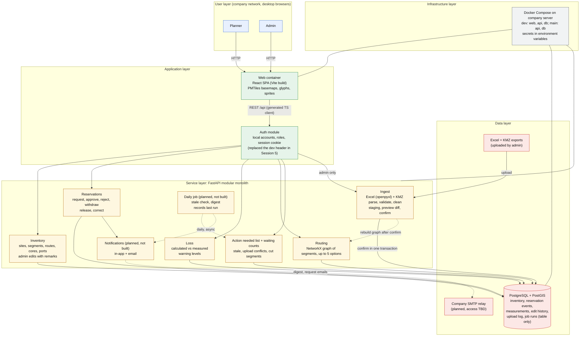

# Fiber Dashboard: Epic Architecture Specification

Last verified: 2026-11-20, commit b4e4393. Matches the code on `dev`. Features not built yet are marked "Planned, not built".

Source: `docs/PRD.md` (26 October 2026). Where this document and the PRD disagree, the PRD wins.

Note on the template: the `breakdown-epic-arch` template assumes Next.js, tRPC, Stack Auth, Redis, Qdrant and n8n. The PRD fixes a different stack (React + Vite, FastAPI, local accounts, PostgreSQL + PostGIS), so those template components are left out on purpose.

## 1. Epic Architecture Overview

One Docker Compose stack on a company-managed server, with three runtime pieces. Development (`dev` branch) runs `db`, `api` (with reload) and `web` (Vite dev server). Production (`main` branch) runs `db` and `api` only: the api image builds the web app in a Node stage and FastAPI serves it from `api/static`, with the map tiles mounted read-only. Production code on `main` is the runtime code copied from `dev`, without the DEV seeds, tests, docs and dev tools.

- **Web:** a React + TypeScript single-page app (Vite build) plus the self-hosted map assets (PMTiles basemap, glyphs, sprites) and the Geist and Geist Mono fonts, served as static files. Desktop only, minimum width 1200px, light theme only.
- **API:** one FastAPI service, built as a modular monolith. It holds every business rule: ingest (Excel and KMZ), inventory, reservations, loss, routing and identity. Notifications and the daily job are planned, not built; they will run inside this service.
- **Database:** PostgreSQL with PostGIS. It is the source of truth after the first import.

The design rules that shape everything else:

1. **Append-only history.** Reservations, measurements and data edits are insert-only rows. Current state is derived from them, never overwritten. Nothing is deleted.
2. **The database enforces invariants where it can.** "First request submitted wins" is a unique constraint on active core holds, not an application check.
3. **Every write carries `user_id`.** A dev-only header supplied the user until login landed (Session 5); the session cookie replaced it with no change to the domain code. The header still works only when `APP_ENV=development` and `ALLOW_DEV_HEADER=1`.
4. **Contract first.** FastAPI's OpenAPI spec generates the TypeScript client (`openapi-typescript`). Stub endpoints come first, and real logic replaces them one endpoint at a time.
5. **No data leaves the network.** No external map API, CDN or font host. Email, when built (planned), goes only through the company SMTP relay.

## 2. System Architecture Diagram



Solid lines are synchronous request paths. Dotted lines are asynchronous or scheduled flows.

## 3. High-Level Features & Technical Enablers

### Features (in build order from the workflow)

| # | Feature | PRD story | Key architectural points |
| --- | --- | --- | --- |
| F1 | Search, Cores table | 1 | One search endpoint over customer, segment and core, used by the global search in the top bar. Core status is derived (see E3). Filters for region and route type ("n of N segments"). The Cores table (`docs/DESIGN.md` section 3) shows one row per core or per collapsed run, with the ports at both ends from the Excel's paired ports. |
| F2 | Reserve cores and approval flow | 2, 3 | Reservation events are append-only. Route reservations are one request across many segments. A request holds cores; approval reserves them; rejection or withdrawal frees them. A release can cover only some cores of a route reservation; it frees their locks and keeps all records. Corrections touch only customer and planned date. A route reservation takes N cores per segment, assigned from the first free cores on each segment by default. A reservation history endpoint (TASK-077) feeds the core detail (history, Release). |
| F3 | Action needed list and waiting counts | 2, 3 | Shown as the Approvals tab count (amber, admin) and the Action needed count badge on My reservations. A query, not a stored flag: stale reservations, release requests, upload conflicts, cut segments, pending approvals. |
| F4 | Login and roles | 7 | Local accounts, planner and admin, forced password change, deactivation only. Built right after F2. Admins reach the users screen from a "Users" item in the account menu (admin only). |
| F5 | Loss per core | 4 | Calculated loss per core in one backend function (owner formula: km x 0.25 + 0.1 x km/4 splices + 0.5 x 2 connectors, rounded to 2 decimals). Measured loss per core from field tests, kept as history; the latest is shown. Coverage is segments with a reading out of all segments. Shown in core details and the reserve box list; never on the map or the segment diagram. |
| F6 | Admin upload | 8 | Upload, Preview, Confirm. The site master (its own workbook, separate from the Reservation workbook: sites sheet only; a DC sheet is ignored) uses a replace-file model with Added, Changed, Missing and Problem groups (see E6b). Preview groups New, Changed, Conflicts, Not in this file, Needs review, Rejected. Every row is kept raw in staging with sheet name, row number, status (Ready, Needs review, Rejected) and reason. Upload never touches reservations. A segment list upload (Link, Distance, optional Site A, Route, Section) creates and updates segments between sites already in the dashboard; a row with an unknown site is Needs review and skipped. A KMZ route lines upload draws segment lines (see E11). See E6a for the row rules (the old sample workbook was removed 16 Nov 2026). |
| F7 | Admin editing | 8 | Fiber cut on a segment (cut or restore), then segment and site details (third cut). Remarks are optional everywhere, including closing the reservation import and a site master override (owner decision, 19 November 2026); a blank remark is stored as NULL. Older rows may still hold "no reason given". Every edit protects the field. |
| F8 | Route planning | 5 | NetworkX graph of segments (each segment joins two sites, weighted by km); any site to any site; up to 5 options with km, Calculated loss, minimum free cores (the bottleneck), loss confidence; Optimise for shortest distance or most free cores; options without enough cores last; a "Best match" tag. Shown as the 2D route ribbon on the map page. |
| F9 | Inventory page | 6 | The home page: MapLibre map (8 of 12 columns, never shrunk) with segment lines over the basemap (straight unless a KMZ or seed shape is stored for the segment) and the segment list beside it, the segment diagram with "Reserve cores", then the Cores table; reserving opens as a box over Inventory (`docs/DESIGN.md` section 3). A segment with a stored route geometry draws road-shaped; one without draws a straight line. The fallback is a plain SVG map of sites and straight segment lines, without a basemap. Selection lives in the URL hash. Search and lists work without the map. |
| F10 | Email digest and request emails | 3, 2 | Daily digest and new-request emails through SMTP (first cut). Planned, not built. |

### Technical enablers

**E1. Docker Compose stack (Session 0).** Two compose setups, one per branch, each running unchanged on every machine; anything machine-specific lives only in `.env`, which is kept out of the repository. `dev`: `db` (PostGIS image), `api` (FastAPI, Uvicorn with reload and source mounts) and `web` (Vite dev server). `main`: `db` and `api` only; the api image builds the web app in a Node stage, FastAPI serves the build from `api/static`, and `web/public/map` (from `scripts/get-tiles.sh`) is mounted read-only. Production serves plain HTTP with `COOKIE_SECURE=0` and has no TLS proxy (owner decision, 18 November 2026). `GET /api/health` is liveness. `GET /api/ready` returns 503 when the database is not at the Alembic head. `scripts/backup-db.sh` writes dumps and `scripts/restore-check.sh` loads one into a scratch database to check it.

**E2. Schema and migrations (Session 1).** Alembic; the migrations are squashed into one baseline, `api/alembic/versions/0001_baseline.py`, plus later migrations (0002 port unique per site, 0003 measurement creator, 0004 drop core circuit ID, 0005 btree indexes on foreign-key columns, 0006 drop `postgis_tiger_geocoder` and `postgis_topology`, 0007 rename `reason` to `remarks` on `data_edits` and `reservation_events` and make it optional) (raw SQL: tables, the views `core_status_v`, `reservation_state_v` and `reservation_unassigned_v`, `forbid_change` append-only triggers, and the indexes). Internal IDs for sites, segments and routes. Natural keys for upload matching: segment by (site A, site B), since two sites never share more than one segment; route by its two end sites (several routes can share the same two end sites, so that index is not unique); port by Port ID (an FDF or ODF label, see `api/app/port_label.py`, unique per site). Route type is not stored or uploaded: it is derived on every read from the kinds of the segment's two end sites (`api/app/link_type.py`: DC-DC, DC-TOC, Metro, Trunk); segments have no route type column (dropped from the baseline in the November 2026 cleanup). Cores have no circuit ID (dropped by migration 0004, 11 Nov 2026). Site names are unique across all regions. Regions are North, Central, South and East Coast; a new value comes by migration, and an unknown region (after spelling variants are mapped) is a Needs review upload row. Sites also get `kind` 'data_center' with `lrd_site_id`, a link to the LRD site row from the site list (the DC is not a separate place; the map shows the linked site as a data center), and a `details` jsonb column for every non-core Excel column (part of the baseline, as are the next items). Segments get `survey_cores`. The baseline also has `segments.cable_size` (info only, default 144, admin-editable), `reservations.unassigned_cores` (int, not null, default 0, set at insert) `reservations.unassigned_segment_id` (the segment a count-only reservation holds cores on), the event type 'assigned', and the views `reservation_state_v` and `reservation_unassigned_v` (E4a). Measurements store `test_method` and `field_team`. It also has `sites.active` (bool, default true; a site missing from a site master upload is set inactive, never deleted) and the upload kind 'site_master'. All timestamps are `timestamptz` stored in UTC.

**E3. Derived core status.** One SQL view gives each core's current status, in priority order (a fiber cut, `segments.fiber_cut`, makes all cores on that segment unavailable; it is not a core status):

```text
In use     if the Excel marks it in use
Reserved   if it has an approved, unreleased reservation
Requested  if it has a pending request
Available  otherwise
```

**E4. Reservation event log and core holds.** `reservation_events` is insert-only (request, approve, reject, withdraw, keep (offered only on a stale reservation), release request, release, decline release, correct, assigned), each with `user_id`, timestamp and optional remarks. Alongside it, a `core_holds` table has one row per held core, with `core_id` as its primary key. The request event and its holds are written in the same transaction. A second request for the same core fails on the key, and the API returns the taken cores so the planner can pick again. Reject, withdraw and release delete the hold rows; the events keep the history. (`core_holds` is the only table rows are removed from: it is a lock table, not a record.) Release is not deletion: it adds a `released` event, and the reservation, its cores and all events stay. A `release_cores` table records which cores each `release_requested`, `released` and `release_declined` event covers, so a release can free some cores of a route reservation and leave the rest reserved. Releasing all cores ends the reservation. `reservations` and `reservation_cores` are append-only too (triggers reject UPDATE and DELETE). A `corrected` event changes only customer and planned date on an approved reservation; cores are never corrected.

**E4a. Verified capacity and count-only reservations.** A segment has one core cell per verified core: cores numbered 1 to `segments.survey_cores`, with port labels where Core assignment gave them and blank ports otherwise. `cable_size` is never turned into cells. The API returns `not_surveyed_cores` (cable_size minus survey_cores, shown as a line "N cores not verified"). A segment with a null `survey_cores` is not verified and cannot be booked until an admin enters a count (an admin segment edit through `data_edits`, remarks optional); a higher count just makes more cores appear. A count-only reservation has `unassigned_cores = N` and no `reservation_cores` rows. Its remaining unassigned count is derived: `unassigned_cores` minus the cores added by its 'assigned' events. Free for a segment = Available cells minus the remaining unassigned cores of active reservations on it. Every booking path (request, import) checks it and returns 409 above that number. The admin-only `assign` action inserts `reservation_cores` and `core_holds` rows and an 'assigned' event in one transaction, and cannot add more cores than remain unassigned. Release of a count-only reservation ends its remaining unassigned count with it. Remaining unassigned is derived: `unassigned_cores` minus the `reservation_cores` rows of the reservation (a count-only reservation gets cores only through assign), and 0 once the reservation is no longer pending or approved (view `reservation_unassigned_v`).

**E5. Edit history and protected fields.** One `data_edits` table: entity type, entity ID, field, old value, new value, remarks (optional), `user_id`, timestamp. A field is protected from uploads when an edit row exists for it. Admin corrections to reservations go through E4, not here.

**E6. Two-phase upload.** Parse and validate into a staging area keyed by upload ID (openpyxl for Excel, zipfile + XML for KMZ). Compute the preview diff against current data and protected fields. On confirm, apply everything in one transaction and write the upload log (who, when, counts, changes). Nothing outside staging changes before confirm. The Reservation workbook and the site master workbook are separate uploads, each recognised by its sheets' headers. Reservation apply re-checks Free under the same segment locks the request path takes. A request that waits more than 5 seconds for a lock (`lock_timeout`, per transaction) gets 409. Reservation rows from Excel are a separate preview group and import only until the one-time "Close reservation import" switch is closed. The switch is a `data_edits` row (entity 'system', entity_id 0, field 'reservation_import', new_value 'closed', with user and optional remarks), so no new table is needed; staging and confirm both check it, and it cannot be reopened in the MVP. After it is closed, reservation rows are ignored and shown as a warning.

**E6a. Layered parsing, row status and the sample workbook.** Every row of every imported sheet is first stored raw in `upload_rows` (sheet name, row number, raw cells as jsonb). Parsers then add parsed fields on top; the raw text is never dropped, and a parser failure sets the row to Needs review instead of stopping the upload. Each row has a status (Ready, Needs review, Rejected) and a reason; Needs review means a row the admin must look at. The admin fixes a row in the dashboard, remarks optional (a `data_edits` row, protected from later uploads) or cleans the Excel and uploads again. One module, `api/app/ingest/checks.py`, holds the check functions (coordinate box, site lookup, region spelling map, port range pairing, blank requestor, duplicate site names). The upload preview and `app.load_data` use them. The standalone `excel_check` command and the old sample-workbook seed (`seed.py`, sheets Site Location and DC List) were removed on 16 Nov 2026; data loads via `app.load_data`.

Sheet handling (sample workbook received 22 October 2026; it is no longer parsed as one file: real uploads are two separate workbooks, Reservation and the site master with the Sites sheet):

- **Reservation** (header row 1): forward-fill merged Region cells and title rows (stored as `group_label`); map region spellings; split Nodes `AABB-BBCC` on '-' and match the segment by the unordered site pair, stripping "(additional core)" and setting the reservation's `additional` flag; take Distance(KM) and Core Secured (`segments.survey_cores`) from it; pair the two sites' Core assignment port ranges in order, and mark the row Needs review on a length mismatch or malformed range such as `P23-282`; when Core assignment is blank and No of core requested has a count, the row is Ready and imports as a count-only reservation (`unassigned_cores = N`, no cores); when both are blank it is Needs review; map Fiber core requestor to the customer (blank is Rejected, trigram near-matches shown in the preview); ignore Aging(days) and Core balance (Core balance is Core Secured minus assigned, which the Free logic reproduces). Port Info, Contractor and Remark are stored raw. Fiber core monitoring is free text; the UI suggests values already in use (no list table, no hardcoded codes). Fiber monitored is stored as Y, N or WIP.
- **Monitoring**: not imported in the MVP.
- **Site Location / LRD sites sheet** (found by headers site_name, latitude_in_decimal, longitude_in_decimal; header on row 4 in the sample; about 36,000 rows): every row is a site. Name, kind, lat/long (PostGIS point) and region are columns; an optional Type column sets `sites.kind` (blank or Trunk = site, DC = data_center, TOC = toc; anything else is Needs review; without the column existing kinds are left alone); every other Excel column goes into `sites.details` jsonb. Coordinates outside the Southeast Asia box (about latitude -11 to 21, longitude 92 to 141) are Needs review.
- **DC List / DC sheet**: no longer imported (removed 16 Nov 2026; the site master upload ignores it, and the old sample workbook, `seed.py` and `excel_check` are gone, data loads via `app.load_data`). It was: a site of kind 'data_center' linked to its LRD site row, with its own lat/long when valid, else the linked site's ("location from site <LRD>"). E2E Status, Fiber Leg, State, City and Cluster go in `details`.
- "Nodes" is only an Excel column name in the parser. No table, column or class uses the word.

**E6b. Site master upload (replace-file model).** Its own workbook (separate from the Reservation workbook), one Sites sheet. `api/app/ingest/` finds the sheet by its headers (case and spacing ignored), never by name. If none matches, that part is blocked with a message naming the expected headers. Rows go to staging (`upload_rows`, kind 'site_master'); nothing else is written until apply. Per sheet the diff against the database gives Added, Changed, Missing from the file and Problem. Keys: sites on `site_name`. Apply, in one transaction: insert Added; update Changed with a `data_edits` row per field (remarks: the upload); set Missing `active = false` unless a segment or reservation uses the site (then keep it active and warn); Problem rows stay Needs review. A field with a `data_edits` row is protected and shows "edited in dashboard, file differs". Whole-file checks block that sheet only: empty, required headers missing, duplicate keys, or 10% or more fewer rows than the database (admin override with a confirmation). The values empty, "TBA", "N/A", "NA", "-" and "TBC" are blank. The DC List sheet, its LRD link and "possible rename" were removed on 16 Nov 2026; existing `lrd_site_id` values stay as stored. A site with invalid coordinates is Needs review and not drawn, but still gets segments and routes. The "current file" is the latest applied site master upload (name, date, user, row counts come from `uploads`); earlier uploads stay for comparison. Rollback of an applied upload is not built in the MVP (Later / parked).

Reservations are insert-only, so the new reservation fields (`group_label`, `additional`, `unassigned_cores`, `cv_ready_date`, `contractor`, `remark`, `port_info_raw`, `monitoring_code`, `fiber_monitored`) are all set in the INSERT. None needs an UPDATE, so the `forbid_change` trigger stays untouched.

**E7. Stale rule as a query.** A reservation is stale when its latest approve or keep event (or its import date when undated) is more than 3 months old and it has no release. Computed at read time, so there is no flag to drift. "Today" and the 3-month boundary use the Asia/Kuala_Lumpur date; the daily digest uses the same date.

**E8. Routing graph.** A NetworkX graph in which each segment joins two sites (weight = km), built in memory from the Postgres segment table lazily on first use (not at startup), skipping segments with `fiber_cut`; a segment with no distance weighs `FALLBACK_KM` (10 km). The graph is cached per process behind a lock and cleared by `invalidate()` after a segment change (including an upload). Any site can route to any site. Candidate paths come from `shortest_simple_paths` (capped at `MAX_CANDIDATES`, more than the 5 shown at most, `SHOWN`); the API returns the best options (sanity cap 5; normally up to 3) ranked by Optimise for: km (shortest, default) or free cores (the fewest free cores on any segment of the path, higher is better). Only candidates with weight up to `MAX_DETOUR` (1.5) times the shortest path are kept, and a near-copy of a kept candidate (one that contains all its segments) is dropped, so one or two options is normal and the list is never padded to 3. Options with fewer free cores than needed come last, and the first option that fits gets "Best match". No "lowest loss" ranking until loss data exists. Routes are labels only. The graph holds only sites that have segments (hundreds), even though the database holds about 36,000 sites, so NetworkX in memory stays. There is no graph database. 36,000 sites and up to about 100,000 cores are small for PostgreSQL with indexes: pg_trgm GIN on site names, btree on `cores.segment_id`, GiST on site location.

**E9. Scheduler with run record (planned, not built).** Only the `job_runs` table exists in the schema; nothing writes to it. No daily job, digest or email runs. Planned: a daily job (a cron entry or a small looping service; APScheduler is not installed) running the `api` code, with `job_runs` recording each run by date so a restart never sends twice, and a PostgreSQL advisory lock so only one Uvicorn worker runs the job.

**E10. Auth.** Passwords hashed with Argon2. An httpOnly session cookie on the same origin as the SPA (no token storage in the browser). Role checks are FastAPI dependencies. Login (Session 5) is done: local accounts, Argon2, the httpOnly session cookie and a `sessions` table. It replaced the dev-only header. Failed sign-ins are throttled (429) with counters in process memory, so each worker counts on its own and a restart resets them.

**E11. Map assets and KMZ lines.** One PMTiles extract capped at zoom 14, plus glyphs, sprites and a light style (dark is Later), all served as static files by `web` (PMTiles is read with HTTP range requests, so no tile server is needed). The map (`api/app/map/service.py`) is served as GeoJSON: each segment is drawn between its sites (data center square, other site diamond, line weight by route type, free-cores chip). A segment without a stored shape draws as a straight line; a segment with a stored route geometry draws road-shaped. There is also a per-segment KML export (`segment_kml`). The dev seed `app.seed_dev_network` adds road-shaped DEV lines from `api/app/dev_road_shapes.json`. KMZ import is built: the Upload tab "KMZ route lines" (`api/app/ingest/kmz_router.py`) and `python -m app.load_kmz USERNAME data/file.kmz [--folder "propose route"]` (`api/app/load_kmz.py`, zipfile and xml.etree). It reads the lines of one KML folder (default "propose route"; a file with no folders, or a blank folder name, reads every line). Pins and other folders are ignored. Lines are matched to segments by their Placemark title `AAAA-BBBB` (two site names): pieces with the same title are joined into one line, oriented site A to site B, and stored as the segment's own PostGIS LineString (one route row per segment). Untitled lines, titles that are not a site pair and pairs with no segment are shown as Needs review and skipped. Preview first; apply replaces a segment's line. Segments are never created from a KMZ. By default the map shows only sites that have segments plus segment lines; the other sites are an optional clustered layer. No tile or response caching: test performance and cache only if slow.

**E12. Typed API client.** `openapi-typescript` generates the frontend types from FastAPI's OpenAPI spec. Regenerate after every endpoint change.

**E12a. Inventory page state.** One page holds the segment and route workflow. The account menu (top right) holds Sign out and, for admins, Users. Loss shows per core in core details and the reserve box. The selection is written to the URL hash (`#segment=AABB-BBCC`, `#route=AABB-DDEE`) so links can be shared; the page reads the hash on load. Every list and search works without the map or tiles.

**E13. Tests, logging and lint.** `api/app/observability.py` sets up logging (`LOG_LEVEL`) and logs one line per 409, server error or slow request, never the query string. ruff (`api/ruff.toml`) and oxlint (`web/.oxlintrc.json`) enforce the code-style rules. pytest for the reservation flow (request, approve, reject, release, correct), upload validation and the loss bands, against a real PostGIS container. Playwright for the Cores table checks (status not by colour alone, keyboard operation, 4.5:1 contrast) and the map page at widths 1200, 1280, 1440 and 1920.

### Performance approach

- Indexes: pg_trgm GIN on site names, GiST on site geometry, composite indexes on events, measurements and edits, and a unique site-pair index on segments using LEAST/GREATEST so the order of the two sites does not matter.
- The routing graph is built lazily on first use, cached per process, and cleared by `invalidate()` after a segment change.
- Path search is bounded: `MAX_CANDIDATES`, `MAX_DETOUR` 1.5, and at most `SHOWN` options.
- State is derived at read time (core status, unassigned cores, stale) instead of stored flags, so nothing drifts and nothing needs a write to stay current.
- The basemap is self-hosted PMTiles read by range requests, capped at zoom 14. The database engine uses `pool_pre_ping`. Closing the reservation import takes an advisory lock.
- No caching until something is measured slow (no HTTP, tile or response caching, no gzip middleware). Known ceiling: each Uvicorn worker keeps its own copy of the routing graph; dev runs a single `--reload` process.

## 4. Technology Stack

| Layer | Choice |
| --- | --- |
| Frontend | React, TypeScript, Vite, Tailwind CSS (`@tailwindcss/vite`), Geist fonts (`@fontsource-variable`) |
| API client | `openapi-typescript` generated from FastAPI's OpenAPI spec |
| Map | MapLibre GL JS, PMTiles (OpenStreetMap extract, zoom 14 cap), self-hosted glyphs and sprites |
| Backend | Python, FastAPI, Uvicorn, SQLAlchemy, Alembic, Pydantic |
| Ingest | openpyxl (Excel); zipfile and XML parsing (KMZ) |
| Routing | NetworkX |
| Auth | Local accounts, Argon2 password hashes, httpOnly session cookie |
| Database | PostgreSQL with PostGIS |
| Lint | ruff (Python), oxlint (web) |
| Testing | pytest, Playwright |
| Deployment | Docker Compose on a company-managed server, one stack per branch (host confirmed with IT before go-live) |

Planned, not built, not installed: the daily job and a company SMTP relay for email (access TBD). A cron entry or a small looping service is simpler than APScheduler; the E9 plan with `job_runs` and an advisory lock still applies.

### Pinned versions (pinned 21 October 2026, checked against the lock files 19 November 2026)

Latest stable at the time of pinning, per the data owner's "latest" rule. Every pin below matches `api/requirements.lock`, `web/package.json`, the Dockerfiles and `docker-compose.yml` as of 19 November 2026.

| Item | Version |
| --- | --- |
| Python | 3.14.8 (3.15 skipped: 12 days old, FastAPI, Uvicorn, argon2-cffi and python-multipart do not list it yet) |
| Node.js (LTS) | 24.22.1 |
| PostgreSQL | 18.6 (19 is not GA) |
| PostGIS image | `postgis/postgis:18-3.6` pinned by digest in `docker-compose.yml`; PostGIS 3.6.4, GEOS 3.14.1 (checked 21 October 2026) |
| FastAPI / Uvicorn | 0.157.0 / 0.54.0 |
| SQLAlchemy / Alembic | 2.1.5 / 1.20.0 |
| Pydantic / psycopg | 2.14.1 / 3.3.6 |
| openpyxl | 3.1.5 |
| NetworkX | 3.7 |
| argon2-cffi / python-multipart | 25.1.0 / 0.0.32 |
| pytest / httpx / ruff | 9.1.1 / 0.28.1 / 0.14.6 |
| React / React DOM | 19.3.1 |
| Vite | 8.3.5 |
| TypeScript | 6.0.3 (7.x skipped by decision: new native-port major, tooling support unproven) |
| Tailwind CSS | 4.3.3 |
| maplibre-gl / pmtiles | 6.14.0 / 4.5.0 |
| openapi-typescript | 7.13.0 |
| Playwright | 1.64.1 |
| oxlint | ^1.88.0 (range, not exact pin) |

## 5. Technical Value

**High.** Reservations move out of Excel into one attributable, append-only record, which the PRD's success criteria depend on (100% of reservations in the dashboard, 0 stale items older than 4 months). The event log, edit history and protected fields also make the dashboard safe to run as the source of truth while the Excel feed keeps arriving.

## 6. T-Shirt Size Estimate

**L.** Ten features on a small, well-known stack with modest data (about 36,000 sites, up to about 100,000 cores, 50 users). The size is in the rules, not the scale: event-sourced reservations, two-phase upload with conflict handling, and the first use of PostGIS, MapLibre and PMTiles. For one person in about 11 days it is at the edge of feasible, so the PRD's cut order (email, then real KMZ map, then segment and site editing) is part of the plan, not a fallback.

## Open decisions that affect the architecture

| Decision | Affects | Default until confirmed |
| --- | --- | --- |
| SMTP relay access | F10, E9 (not built) | Later, per data owner. In-app Action needed list and counts ship first |
| Production web serving | E1 | Decided: FastAPI serves the static build from the api container (`main`); plain HTTP, no TLS proxy (owner, 18 November 2026) |

Decided by the owner (26 October 2026): straight segment lines in the MVP with one mock route to prove drawn shapes; no site master rollback in the MVP; the site master is a separate workbook from the Reservation workbook; loss shows per core (core details, reserve box); Users is in the account menu. Since then (6 November 2026) the KMZ import is built: segments with a stored shape (KMZ or dev seed) draw road-shaped, the rest stay straight.

Resolved by data owner: two sites never have more than one segment, so a segment is keyed by its site pair. Many cores per segment is normal.
