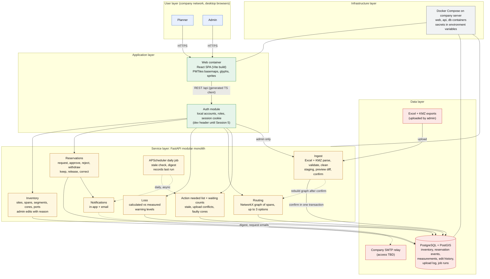

# Fiber Dashboard: Epic Architecture Specification

Source: `docs/PRD.md` (26 October 2026). Where this document and the PRD disagree, the PRD wins.

Note on the template: the `breakdown-epic-arch` template assumes Next.js, tRPC, Stack Auth, Redis, Qdrant and n8n. The PRD fixes a different stack (React + Vite, FastAPI, local accounts, PostgreSQL + PostGIS), so those template components are left out on purpose.

## 1. Epic Architecture Overview

One Docker Compose stack on a company-managed server, with three runtime pieces:

- **Web:** a React + TypeScript single-page app (Vite build) plus the self-hosted map assets (PMTiles basemap, glyphs, sprites) and the Geist and Geist Mono fonts, served as static files. Desktop only, minimum width 1200px, light theme only.
- **API:** one FastAPI service, built as a modular monolith. It holds every business rule: ingest (Excel; KMZ later), inventory, reservations, loss, routing, identity and notifications. The daily job (APScheduler) runs inside this service.
- **Database:** PostgreSQL with PostGIS. It is the source of truth after the first import.

The design rules that shape everything else:

1. **Append-only history.** Reservations, measurements and data edits are insert-only rows. Current state is derived from them, never overwritten. Nothing is deleted.
2. **The database enforces invariants where it can.** "First request submitted wins" is a unique constraint on active core holds, not an application check.
3. **Every write carries `user_id`.** A dev-only header supplies the user until login lands (Session 5); then a session cookie replaces it with no change to the domain code.
4. **Contract first.** FastAPI's OpenAPI spec generates the TypeScript client (`openapi-typescript`). Stub endpoints come first, and real logic replaces them one endpoint at a time.
5. **No data leaves the network.** No external map API, CDN or font host. Email goes only through the company SMTP relay.

## 2. System Architecture Diagram



Solid lines are synchronous request paths. Dotted lines are asynchronous or scheduled flows.

## 3. High-Level Features & Technical Enablers

### Features (in build order from the workflow)

| # | Feature | PRD story | Key architectural points |
| --- | --- | --- | --- |
| F1 | Search, cores grid | 1 | One search endpoint over customer, span, circuit ID and core, used by the global search in the top bar. Core status is derived (see E3). Filters for region and route type ("n of N spans"). The cores grid is 12 per row; the held table shows the ports at both ends from the Excel's paired ports. |
| F2 | Reserve cores and approval flow | 2, 3 | Reservation events are append-only. Route reservations are one request across many spans. A request holds cores; approval reserves them; rejection or withdrawal frees them. A release can cover only some cores of a route reservation; it frees their locks and keeps all records. Corrections touch only customer and planned date. A route reservation takes N cores per span, assigned from the first free cores on each span by default. A reservation history endpoint (TASK-077) feeds the core detail (history, Keep, Release). |
| F3 | Action needed list and waiting counts | 2, 3 | Shown as the Approvals tab count (amber, admin) and the Action needed count badge on My reservations. A query, not a stored flag: stale reservations, release requests, upload conflicts, faulty cores, pending approvals. |
| F4 | Login and roles | 7 | Local accounts, planner and admin, forced password change, deactivation only. Built right after F2. Admins reach the users screen from a "Users" item in the account menu (admin only). |
| F5 | Link loss | 4 | Calculated loss in one backend function (distance × 0.3 dB/km). Measurements kept as history; the latest is shown. Coverage is spans with a reading out of all spans. Shown in the bottom section of the map page: a loss line under the route ribbon (per span and route total), and a "Loss" block below the held table for a single span. No link loss tab. |
| F6 | Admin upload | 8 | Upload, Preview, Confirm. The site master (its own workbook, separate from the Reservation workbook: sites sheet and DC sheet) uses a replace-file model with Added, Changed, Missing and Problem groups (see E6b). Preview groups New, Changed, Conflicts, Not in this file, Needs review, Rejected. Every row is kept raw in staging with sheet name, row number, status (Ready, Needs review, Rejected) and reason. Upload never touches reservations. See E6a for the sample workbook rules. |
| F7 | Admin editing | 8 | Core status (Faulty or Available), then span and site details (third cut). Every edit needs a reason and protects the field. |
| F8 | Route planning | 5 | NetworkX graph of spans (each span joins two sites, weighted by km); any site to any site; up to 3 options with km, estimated dB, minimum free cores (the bottleneck), loss confidence; Optimise for shortest distance or most free cores; options without enough cores last; a "Best match" tag. Shown as the 2D route ribbon on the map page. |
| F9 | Map page | 6 | The home page: MapLibre with straight span lines over the basemap, Find card, Inspector, cores section under the map. Spans are straight lines; KMZ shapes are not in the MVP. One mock route with a drawn shape (two spans between three sites) proves the line-shape path. The fallback is a plain SVG map of sites and straight span lines, without a basemap. Selection lives in the URL hash. Search and lists work without the map. |
| F10 | Email digest and request emails | 3, 2 | Daily digest and new-request emails through SMTP (first cut). |

### Technical enablers

**E1. Docker Compose stack (Session 0).** Three services: `db` (PostGIS image), `api` (FastAPI, Uvicorn), `web` (Vite dev server in development, static build in production). One `.env` file for secrets, kept out of the repository.

**E2. Schema and migrations (Session 1).** Alembic migrations. Internal IDs for sites, spans and segments. Natural keys for upload matching: span by (site A, site B), since two sites never share more than one span; segment by its two end sites (several segments can share the same two end sites, so that index is not unique); port by Port ID. Route type is an attribute of the span, not part of its key. Circuit ID is an optional column on the core. Site names are unique across all regions. Regions are North, Central, South and East Coast; a new value comes by migration, and an unknown region (after spelling variants are mapped) is a Needs review upload row. Sites also get `kind` 'data_center' with `lrd_site_id`, a link to the LRD site row from the site list (the DC is not a separate place; the map shows the linked site as a data center), and a `details` jsonb column for every non-core Excel column (migration 0003). Spans get `survey_cores` (migration 0003). Migration 0004 (Session 4) adds `spans.cable_size` (info only, default 144, admin-editable), `reservations.unassigned_cores` (int, not null, default 0, set at insert) `reservations.unassigned_span_id` (the span a count-only reservation holds cores on), the event type 'assigned', and the views `reservation_state_v` and `reservation_unassigned_v` (E4a). Measurements store `test_method` and `field_team`. Migration 0005 (site master upload, TASK-080) adds `sites.active` (bool, default true; a site missing from a site master upload is set inactive, never deleted) and the upload kind 'site_master'. All timestamps are `timestamptz` stored in UTC.

**E3. Derived core status.** One SQL view gives each core's current status, in priority order:

```text
Faulty     if the latest admin status edit says Faulty
In use     if the Excel marks it in use
Reserved   if it has an approved, unreleased reservation
Requested  if it has a pending request
Available  otherwise
```

**E4. Reservation event log and core holds.** `reservation_events` is insert-only (request, approve, reject, withdraw, keep, release request, release, decline release, correct, assigned), each with `user_id`, timestamp and reason where needed. Alongside it, a `core_holds` table has one row per held core, with `core_id` as its primary key. The request event and its holds are written in the same transaction. A second request for the same core fails on the key, and the API returns the taken cores so the planner can pick again. Reject, withdraw and release delete the hold rows; the events keep the history. (`core_holds` is the only table rows are removed from: it is a lock table, not a record.) Release is not deletion: it adds a `released` event, and the reservation, its cores and all events stay. A `release_cores` table records which cores each `release_requested`, `released` and `release_declined` event covers, so a release can free some cores of a route reservation and leave the rest reserved. Releasing all cores ends the reservation. `reservations` and `reservation_cores` are append-only too (triggers reject UPDATE and DELETE). A `corrected` event changes only customer and planned date on an approved reservation; cores are never corrected.

**E4a. Surveyed capacity and count-only reservations.** A span has one core cell per surveyed core: cores numbered 1 to `spans.survey_cores`, with port labels where Core assignment gave them and blank ports otherwise. `cable_size` is never turned into cells. The API returns `not_surveyed_cores` (cable_size minus survey_cores, shown as a line "N cores not surveyed"). A span with a null `survey_cores` is not surveyed and cannot be booked until an admin enters a count (an admin span edit through `data_edits`, with a reason); a higher count just makes more cores appear. A count-only reservation has `unassigned_cores = N` and no `reservation_cores` rows. Its remaining unassigned count is derived: `unassigned_cores` minus the cores added by its 'assigned' events. Free to reserve for a span = Available cells minus the remaining unassigned cores of active reservations on it. Every booking path (request, import) checks it and returns 409 above that number. The admin-only `assign` action inserts `reservation_cores` and `core_holds` rows and an 'assigned' event in one transaction, and cannot add more cores than remain unassigned. Release of a count-only reservation ends its remaining unassigned count with it. Remaining unassigned is derived: `unassigned_cores` minus the `reservation_cores` rows of the reservation (a count-only reservation gets cores only through assign), and 0 once the reservation is no longer pending or approved (view `reservation_unassigned_v`).

**E5. Edit history and protected fields.** One `data_edits` table: entity type, entity ID, field, old value, new value, reason, `user_id`, timestamp. A field is protected from uploads when an edit row exists for it. Admin corrections to reservations go through E4, not here.

**E6. Two-phase upload.** Parse and validate into a staging area keyed by upload ID (pandas + openpyxl for Excel, zip + XML for KMZ). Compute the preview diff against current data and protected fields. On confirm, apply everything in one transaction and write the upload log (who, when, counts, changes). Nothing outside staging changes before confirm. The Reservation workbook and the site master workbook are separate uploads, each recognised by its sheets' headers. Reservation rows from Excel are a separate preview group and import only until the one-time "Close reservation import" switch is closed. The switch is a `data_edits` row (entity 'system', entity_id 0, field 'reservation_import', new_value 'closed', with user and reason), so no new table is needed; staging and confirm both check it, and it cannot be reopened in the MVP. After it is closed, reservation rows are ignored and shown as a warning.

**E6a. Layered parsing, row status and the sample workbook.** Every row of every imported sheet is first stored raw in `upload_rows` (sheet name, row number, raw cells as jsonb). Parsers then add parsed fields on top; the raw text is never dropped, and a parser failure sets the row to Needs review instead of stopping the upload. Each row has a status (Ready, Needs review, Rejected) and a reason; Needs review means a row the admin must look at. The admin fixes a row in the dashboard with a reason (a `data_edits` row, protected from later uploads) or cleans the Excel and uploads again. One module, `api/app/ingest/checks.py`, holds the check functions (coordinate box, site lookup, region spelling map, port range pairing, blank requestor, duplicate site names). Two entry points use them: the upload preview and the command `docker compose exec api python -m app.ingest.excel_check <file>`, which prints a report and writes nothing to the database.

Sheet handling (sample workbook received 22 October 2026; it holds all four sheets in one file, but real uploads are two separate workbooks: Reservation, and the site master with the sites and DC sheets):

- **Reservation** (header row 1): forward-fill merged Region cells and title rows (stored as `group_label`); map region spellings; split Nodes `AABB-BBCC` on '-' and match the span by the unordered site pair, stripping "(additional core)" and setting the reservation's `additional` flag; take Distance(KM) and Core Secured (`spans.survey_cores`) from it; pair the two sites' Core assignment port ranges in order, and mark the row Needs review on a length mismatch or malformed range such as `P23-282`; when Core assignment is blank and No of core requested has a count, the row is Ready and imports as a count-only reservation (`unassigned_cores = N`, no cores); when both are blank it is Needs review; map Fiber core requestor to the customer (blank is Rejected, trigram near-matches shown in the preview); ignore Aging(days) and Core balance (Core balance is Core Secured minus assigned, which the free to reserve logic reproduces). Port Info, Contractor and Remark are stored raw. Fiber core monitoring is free text; the UI suggests values already in use (no list table, no hardcoded codes). Fiber monitored is stored as Y, N or WIP.
- **Monitoring**: not imported in the MVP.
- **Site Location / LRD sites sheet** (found by headers site_name, latitude_in_decimal, longitude_in_decimal; header on row 4 in the sample; about 36,000 rows): every row is a site. Name, kind, lat/long (PostGIS point) and region are columns; every other Excel column goes into `sites.details` jsonb. Coordinates outside the Southeast Asia box (about latitude -11 to 21, longitude 92 to 141) are Needs review.
- **DC List / DC sheet** (found by headers "DC Name / Link" and LRD; about 100 rows): a site of kind 'data_center' linked to its LRD site row, with its own lat/long when valid, else the linked site's ("location from site <LRD>"). E2E Status, Fiber Leg, State, City and Cluster go in `details`.
- "Nodes" is only an Excel column name in the parser. No table, column or class uses the word.

**E6b. Site master upload (replace-file model).** Its own workbook (separate from the Reservation workbook), two sheets. `api/app/ingest/` finds each sheet by its headers (case and spacing ignored), never by name. If none matches, that part is blocked with a message naming the expected headers. Rows go to staging (`upload_rows`, kind 'site_master'); nothing else is written until apply. Per sheet the diff against the database gives Added, Changed, Missing from the file and Problem. Keys: sites on `site_name`, DCs on "DC Name / Link". Apply, in one transaction: insert Added; update Changed with a `data_edits` row per field (reason: the upload); set Missing `active = false` unless a span or reservation uses the site (then keep it active and warn); Problem rows stay Needs review. A field with a `data_edits` row is protected and shows "edited in dashboard, file differs". Whole-file checks block that sheet only: empty, required headers missing, duplicate keys, or 10% or more fewer rows than the database (admin override with a confirmation). The values empty, "TBA", "N/A", "NA", "-" and "TBC" are blank. A DC missing while a new DC has the same LRD and coordinates is flagged "possible rename". The DC row sets `lrd_site_id` from the LRD column; its location falls back to the linked site's coordinates; with neither valid it is Needs review and not drawn. A site with invalid coordinates is Needs review and not drawn, but still gets spans and routes. The "current file" is the latest applied site master upload (name, date, user, row counts come from `uploads`); earlier uploads stay for comparison. Rollback of an applied upload is not built in the MVP (Later / parked).

Reservations are insert-only, so the new reservation fields (`group_label`, `additional`, `unassigned_cores`, `cv_ready_date`, `contractor`, `remark`, `port_info_raw`, `monitoring_code`, `fiber_monitored`) are all set in the INSERT. None needs an UPDATE, so the `forbid_change` trigger stays untouched.

**E7. Stale rule as a query.** A reservation is stale when its latest approve or keep event (or its import date when undated) is more than 3 months old and it has no release. Computed at read time, so there is no flag to drift. "Today" and the 3-month boundary use the Asia/Kuala_Lumpur date; the daily digest uses the same date.

**E8. Routing graph.** A NetworkX graph in which each span joins two sites (weight = km), built in memory from the Postgres span table at startup and rebuilt after an upload is confirmed or a span is edited. Any site can route to any site. Candidate paths come from `shortest_simple_paths` (the candidate count is set in code, more than the 3 shown); the API returns up to 3 options ranked by Optimise for: km (shortest, default) or free cores (the fewest free cores on any span of the path, higher is better). Options with fewer free cores than needed come last, and the first option that fits gets "Best match". No "lowest loss" ranking until loss data exists. Segments are labels only. The graph holds only sites that have spans (hundreds), even though the database holds about 36,000 sites, so NetworkX in memory stays. There is no graph database. 36,000 sites and up to about 100,000 cores are small for PostgreSQL with indexes: pg_trgm GIN on site names, btree on `cores.span_id`, GiST on site location.

**E9. Scheduler with run record.** APScheduler inside the `api` container. A `job_runs` table records each run by date, so a restart never sends twice. A PostgreSQL advisory lock makes sure only one Uvicorn worker runs the job.

**E10. Auth.** Passwords hashed with Argon2. An httpOnly session cookie on the same origin as the SPA (no token storage in the browser). Role checks are FastAPI dependencies. A dev-only header supplies the user until Session 5 and is disabled outside development.

**E11. Map assets.** One PMTiles extract capped at zoom 14, plus glyphs, sprites and a light style (dark is Later), all served as static files by `web` (PMTiles is read with HTTP range requests, so no tile server is needed). The MVP map draws each span as a straight line between its sites (data center square, other site diamond, line weight by route type, free-cores chip), served as GeoJSON. KMZ shapes are not in the MVP. One mock segment of two spans between three sites carries a stored PostGIS LineString, and the map draws it in place of its straight lines, to prove the shape path end to end. Real KMZ import is Later. By default the map shows only sites that have spans plus span lines; the other sites are an optional clustered layer. No tile or response caching in the MVP: test performance after the MVP and cache only if slow. KMZ routes are named `<site A name> - <site B name>`; the name is split on ` - ` and matched exactly to a segment by its two end sites. No match, or more than one, goes to the validation report. Several segments can share the same two end sites, so multiple matches are expected; to be checked against the mock files arriving 22 October 2026.

**E12. Typed API client.** `openapi-typescript` generates the frontend types from FastAPI's OpenAPI spec. Regenerate after every endpoint change.

**E12a. Map page state.** One page holds the span and route workflow. The account menu (top right) holds Sign out and, for admins, Users. Loss shows in the bottom section (route loss line, single-span Loss block). The selection is written to the URL hash (`#span=AABB-BBCC`, `#route=AABB-DDEE`) so links can be shared; the page reads the hash on load. Every list and search works without the map or tiles. The Inspector tabs Site and Services, and the map layers Services and Data centres, are disabled placeholders ("Later").

**E13. Tests.** pytest for the reservation flow (request, approve, reject, release, correct), upload validation and the loss bands, against a real PostGIS container. Playwright for the cores grid checks (status not by colour alone, keyboard operation, 4.5:1 contrast) and the map page at widths 1200, 1280, 1440 and 1920.

## 4. Technology Stack

| Layer | Choice |
| --- | --- |
| Frontend | React, TypeScript, Vite, Tailwind CSS, shadcn/ui, Recharts |
| API client | `openapi-typescript` generated from FastAPI's OpenAPI spec |
| Map | MapLibre GL JS, PMTiles (OpenStreetMap extract, zoom 14 cap), self-hosted glyphs and sprites |
| Backend | Python, FastAPI, Uvicorn, SQLAlchemy, Alembic, Pydantic |
| Ingest | pandas, openpyxl (Excel); zipfile and XML parsing (KMZ) |
| Routing | NetworkX |
| Scheduling | APScheduler, with a `job_runs` table and a PostgreSQL advisory lock |
| Auth | Local accounts, Argon2 password hashes, httpOnly session cookie |
| Database | PostgreSQL with PostGIS |
| Email | Company SMTP relay (access TBD) |
| Testing | pytest, Playwright |
| Deployment | Docker Compose on a company-managed server (host confirmed with IT before go-live) |

### Pinned versions (21 October 2026)

Latest stable at the time of pinning, per the data owner's "latest" rule. Source: registry lookups by a research subagent, not yet re-verified; Session 0 confirms each by actually installing.

| Item | Version |
| --- | --- |
| Python | 3.14.8 (3.15 skipped: 12 days old, FastAPI, Uvicorn, APScheduler, argon2-cffi and python-multipart do not list it yet) |
| Node.js (LTS) | 24.22.1 |
| PostgreSQL | 18.6 (19 is not GA) |
| PostGIS image | `postgis/postgis:18-3.6` pinned by digest in `docker-compose.yml`; PostGIS 3.6.4, GEOS 3.14.1 (checked 21 October 2026) |
| FastAPI / Uvicorn | 0.157.0 / 0.54.0 |
| SQLAlchemy / Alembic | 2.1.5 / 1.20.0 |
| Pydantic / psycopg | 2.14.1 / 3.3.6 |
| pandas / openpyxl | 3.0.6 / 3.1.5 |
| NetworkX / APScheduler | 3.7 / 3.11.3 |
| argon2-cffi / python-multipart | 25.1.0 / 0.0.32 |
| pytest / httpx | 9.1.1 / 0.28.1 |
| shapely (only if KMZ needs it) | 2.2.0 |
| React / React DOM | 19.3.1 |
| Vite | 8.3.5 |
| TypeScript | 6.0.3 (7.x skipped by decision: new native-port major, tooling support unproven) |
| Tailwind CSS | 4.3.3 |
| Recharts | 3.10.1 |
| maplibre-gl / pmtiles | 6.15.0 / 4.5.0 |
| openapi-typescript | 7.13.0 |
| Playwright | 1.64.1 |
| shadcn/ui | CLI, `npx shadcn@latest`, no pin |

## 5. Technical Value

**High.** Reservations move out of Excel into one attributable, append-only record, which the PRD's success criteria depend on (100% of reservations in the dashboard, 0 stale items older than 4 months). The event log, edit history and protected fields also make the dashboard safe to run as the source of truth while the Excel feed keeps arriving.

## 6. T-Shirt Size Estimate

**L.** Ten features on a small, well-known stack with modest data (about 36,000 sites, up to about 100,000 cores, 50 users). The size is in the rules, not the scale: event-sourced reservations, two-phase upload with conflict handling, and the first use of PostGIS, MapLibre and PMTiles. For one person in about 11 days it is at the edge of feasible, so the PRD's cut order (email, then real KMZ map, then span and site editing) is part of the plan, not a fallback.

## Open decisions that affect the architecture

| Decision | Affects | Default until confirmed |
| --- | --- | --- |
| SMTP relay access | F10, E9 | Later, per data owner. In-app Action needed list and counts ship first |
| KMZ name matching when segments share end sites (real KMZ import, Later) | E11 | Ambiguous names go to the validation report; check against the mock files |
| Production web serving | E1 | Static build served by a small web server container; confirm with IT along with the host |

Decided by the owner (26 October 2026): straight span lines in the MVP with one mock route to prove drawn shapes; no site master rollback in the MVP; the site master is a separate workbook from the Reservation workbook; loss shows in the map page bottom section; Users is in the account menu.

Resolved by data owner: two sites never have more than one span, so a span is keyed by its site pair. Many cores per span is normal. KMZ names are `<site A name> - <site B name>`.
