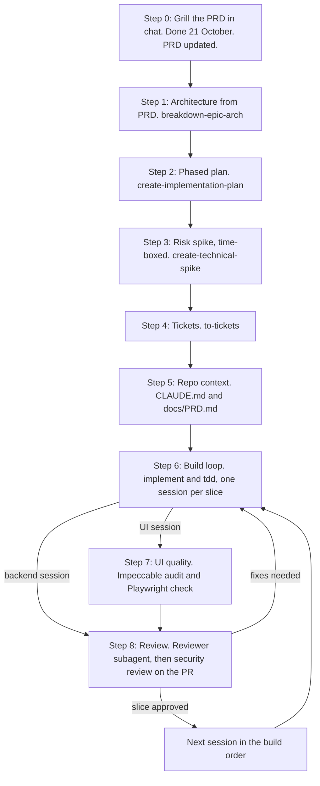

# Fiber Dashboard: Build Workflow (PRD to Review)

How to use this file: Claude (chat or Claude Code) reads it to know which step the project is on, which tool to use, and what the output of each step is. Update the status checklist at the bottom as steps finish.

Constraints: 11 days from 20 October 2026, MVP by 31 October. Cut order from the PRD: email digest first, then real KMZ routes on the map (simple SVG map as fallback), then span and site editing. Core status editing stays. v6 mock already exists. Keep the skill set small, because overlapping skills give conflicting instructions.

## Flowchart

## The steps

| Step | Where | Tool | Output |
|---|---|---|---|
| 0. Grill | Claude chat | `grill-me` (rounds of numbered questions, each with a recommended answer) | Done. PRD updated, export it to `docs/PRD.md` |
| 1. Architecture | Claude Code | `breakdown-epic-arch` (awesome-copilot) | `docs/architecture.md` |
| 2. Phased plan | Claude Code | `create-implementation-plan` (awesome-copilot) | `docs/plan.md`, phases matching the cut order |
| 3. Risk spike | Claude Code | `create-technical-spike` (awesome-copilot), time-boxed | Go or no-go on the riskiest piece (map and routing) |
| 4. Tickets | Claude Code | `to-tickets` (already installed) | One ticket per session below, with blocking edges |
| 5. Repo context | Claude Code | Hand-written `CLAUDE.md`, using HumanLayer's "Writing a Good CLAUDE.md" | `CLAUDE.md` pointing at `docs/PRD.md` |
| 6. Build loop | Claude Code | `implement` and `tdd` (already installed). Superpowers is the alternative. Use one, not both. | Working slice per session |
| 7. UI quality | Claude Code | Impeccable (`/impeccable audit`, `critique`, `polish`) plus Dev Browser or Playwright | UI checked against PRD acceptance criteria |
| 8. Review | Claude Code | Read-only reviewer subagent, then Anthropic's `claude-code-security-review` Action on the PR | Review notes, fixes, merge |

Impeccable replaces both `frontend-design` and `anti-ui-slop`. Do not install them alongside it. Taste Skill is the fallback only if Impeccable output disappoints.

## Build approach: stub first, then real

FastAPI generates an OpenAPI spec for free, so the UI never needs a throwaway mock backend:

1. Stub endpoints return the mock data.
2. Generate a TypeScript client with `openapi-typescript`.
3. Build the real UI against that client.
4. Replace stubs with real Postgres logic one endpoint at a time.

## Session order (Step 6 tickets)

The order builds the last-to-be-cut items first.

- Session 0: Docker Compose (PostGIS, FastAPI, Vite) and `CLAUDE.md`.
- Session 1: Schema and Alembic. Reservations are insert-only events. Internal span ID is the key. Circuit ID is an optional field on the core. Measurements per span. `user_id` on every write. Edit history with reasons. Seed from the mock Excel.
- Session 2: Search, span and core endpoints. Generate the TypeScript client. A dev-only header stands in for the acting user.
- Session 3: Span list, port grid and the Reserve side panel. UI session, runs Step 7.
- Session 4: Approval flow: request, approve, reject, withdraw, release request. Needs review list and bell count.
- Session 5: Minimal login: local accounts, planner and admin roles, forced password change, deactivate. Replaces the dev header.
- Session 6: Loss warning levels per span (green 0 to 3%, amber 3 to 7%, red 7 to 10%). The form is open: chart, small scrollable list, or both. A segment shows x of y spans measured. No distance shown instead of 0 dB. UI session.
- Session 7: Admin upload in three steps: Upload, Preview, Confirm. Protected edits, first import of reservations, upload log.
- Session 8: Admin editing. Core status first (stays in MVP), then span and site details (third cut).
- Session 9: NetworkX routing.
- Session 10: Map, time-boxed. Fall back to the SVG map from the v6 mock if it overruns (second cut).
- Session 11: Email digest, admin request emails and the in-app scheduler (first cut).

After Session 1, run a second grill in Claude Code against the real Alembic migrations.

## Step 7 trial (Session 3)

Before committing to Impeccable, run a 30 minute trial on the port grid. Give Claude the v6 mock and the PRD acceptance criteria, build the component, then run `/impeccable audit`. If it fails the criteria, swap the skill.

Checks the UI must pass:
- Status is never shown by colour alone.
- Text contrast is at least 4.5:1.
- The port grid is keyboard operable.

## Agents (only these two)

- Reviewer: read-only, fresh context, reviews the diff without the bias of having written it. File: `.claude/agents/reviewer.md`.
- UI verifier: drives the app with Playwright and checks the port grid against the PRD rules above. File: `.claude/agents/ui-verifier.md`.

Do not create a separate agent per phase. Make an agent only when it needs a different context, different tools, or an independent opinion.

## Rules for CLAUDE.md

- Reservations are insert-only events. An upload never changes a reservation.
- Every write is attributable to a user, and every data edit needs a reason and is kept as history.
- Nothing is deleted. Accounts are deactivated.
- After the first import the dashboard database is the source of truth and the Excel is a feed. A field edited in the dashboard is protected from uploads.
- Internal span ID is the key. Circuit ID comes from another system and is an optional field on the core, because one span carries many circuits.
- Measurements are stored per span. Distance comes from the Excel.
- Site is the general term for a site, building or equipment location.

## Decisions closed in Step 0

- Requested cores are held, approval reserves them, rejection frees them with a visible reason. Pending requests never expire. A planner can withdraw their own request.
- A reservation goes stale 3 months after approval. Keeping it restarts the clock. An undated import starts at the import date and the preview warns the admin.
- A release request shows in Approvals and the bell count. Cores stay Reserved until an admin releases them. A declined release needs a reason.
- Accounts are deactivated, never deleted. Their pending requests stay in the admin queue and their digests go to all admins.
- Login stays in the MVP and is built right after the approval flow.
- Uploads match spans by the two sites plus route type, and ports by Port ID. A circuit ID in a row attaches to its core. Rows missing from a file are left untouched. Conflicts with a Requested or Reserved core go to Needs review.
- One span carries many circuits, so circuit ID lives on the core.
- Link loss coverage counts spans with a reading.
- Page count, navigation, layout and the visual form of each feature are open for design. The PRD fixes behaviour and accessibility only.
- Admins can edit core status (Faulty or Available), span details and site details. The daily job is an in-app scheduler (APScheduler) that records its last run.

## Still open

- Whether two sites can have more than one span of the same route type (to confirm with the data owners).
- KMZ route name format, until real files are seen.
- SMTP relay access.

## Install notes

- awesome-copilot skills use the SKILL.md format, so they can go in `.claude/skills/`. Skip any that call Copilot-only tools.
- Both awesome-copilot and awesome-claude-code list third-party content. Read each skill before installing.
- Put the Claude Code npm install in the same IT ticket as the other npm installs.

## Status

- [x] Step 0: Grill and PRD update (21 October 2026)
- [x] Step 1: Architecture (`docs/architecture.md`, 21 October 2026)
- [x] Step 2: Phased plan (`docs/plan.md`, 21 October 2026)
- [ ] Step 3: Risk spike
- [ ] Step 4: Tickets
- [ ] Step 5: CLAUDE.md and docs/PRD.md (export ready: Fiber_Dashboard_PRD.md, 21 October 2026)
- [ ] Step 6: Build loop (sessions 0 to 11)
- [ ] Step 7: UI quality (per UI session)
- [ ] Step 8: Review (per session)
